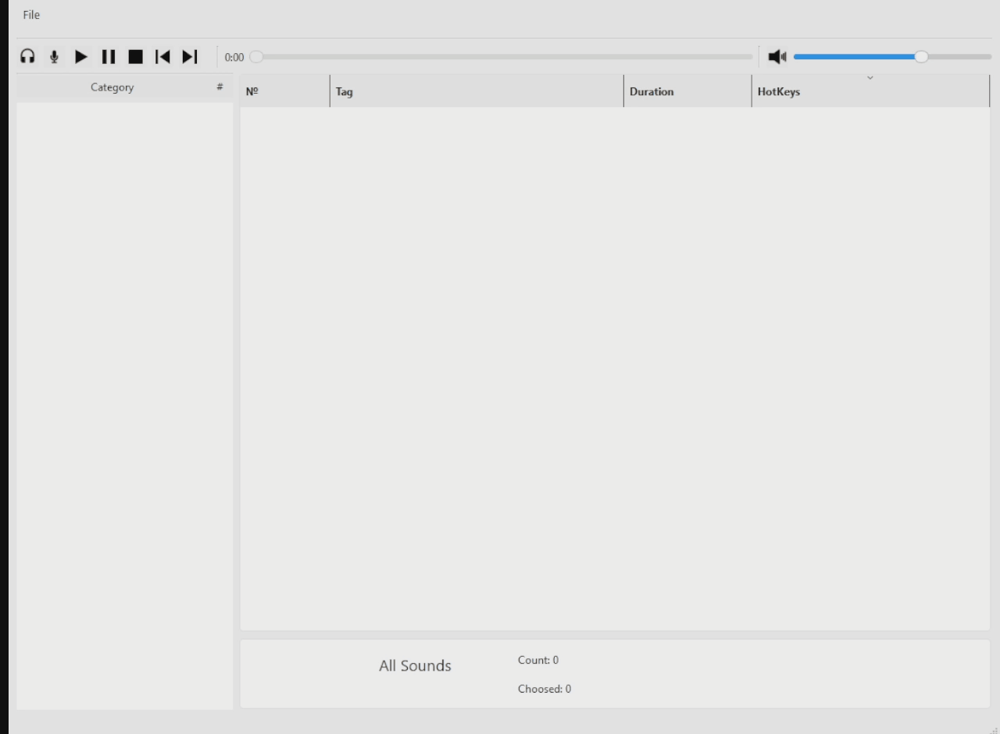
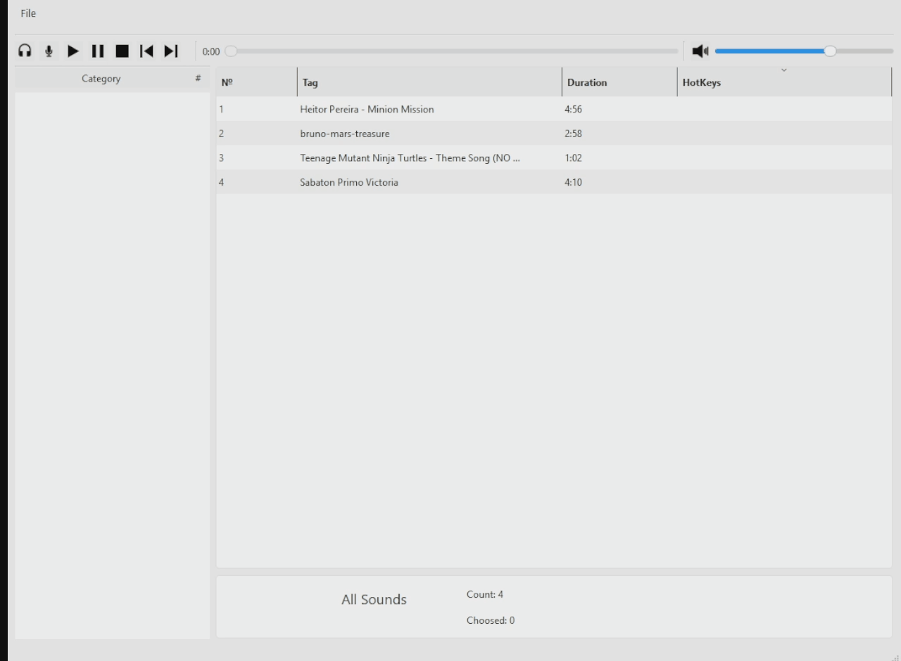
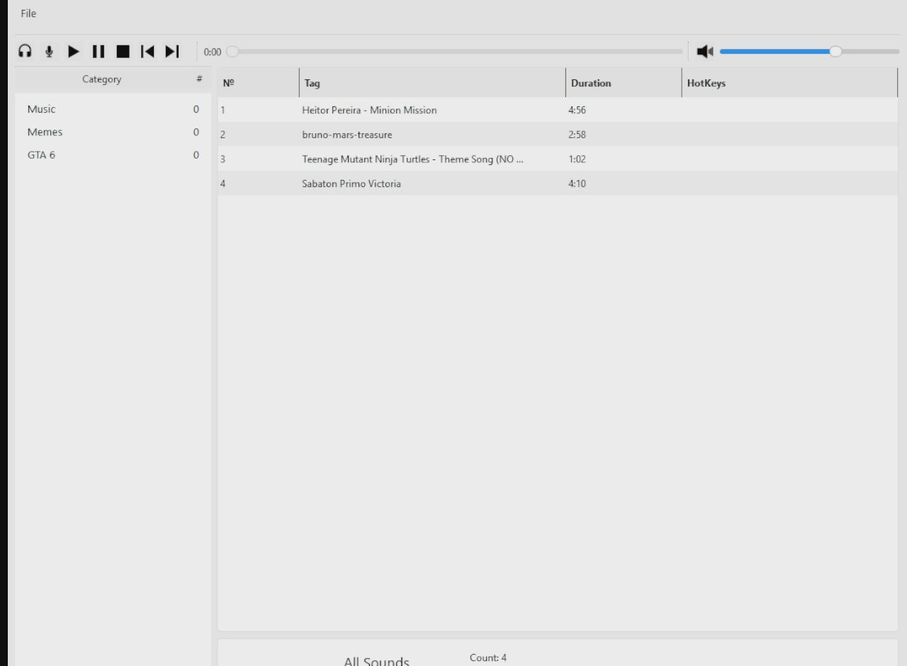
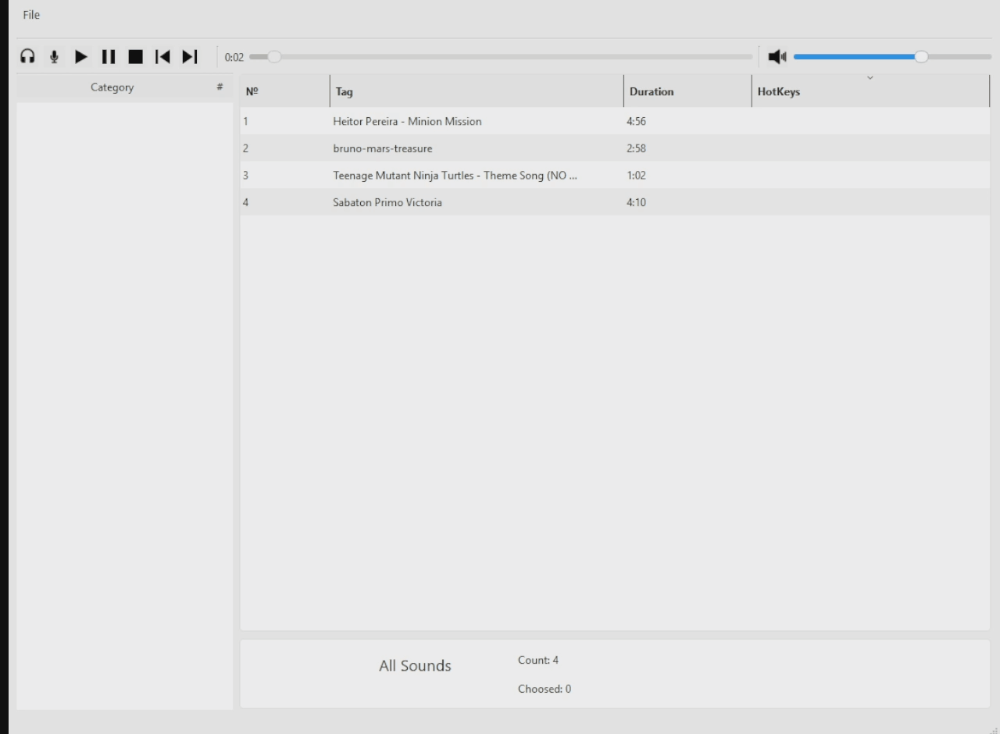
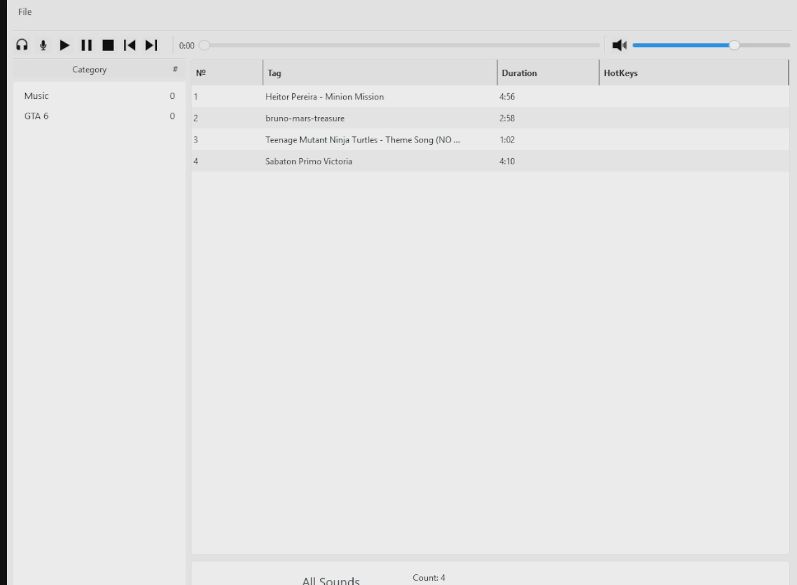

# SoundPad

Desktop application for managing and playing sound effects.

## Features

- Play audio files
- Categories
- Drag & Drop support
- Sorting
- Hotkeys
- Audio output/input device selection
- Save application settings
- Custom category icons

## Screenshots







## Technologies

- C++17
- Qt 6
- Model/View Architecture
- QMediaPlayer
- QAudioOutput
- QSettings
- Drag & Drop
- Inno Setup

## Installation

1.  Download the installer.
2.  Run `SoundPad Installer.exe`.
3.  Launch **SoundPad**.

## Building

Requirements:

- Qt 6.x
- CMake
- MSVC 2022

```bash
git clone https://github.com/Flaminius889/Simple-SoundPad
cd SoundPad
mkdir build
cd build
cmake ..
cmake --build .
```

## Project Structure

build/
include/
resources/
src/
ui/

## Future Plans

- Icons for categories
- Add hotkey for multimedia buttons in settings
- Add output on mic

## License

MIT
